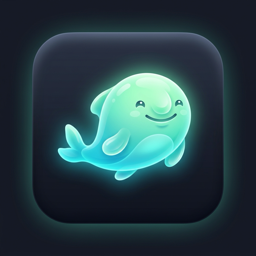
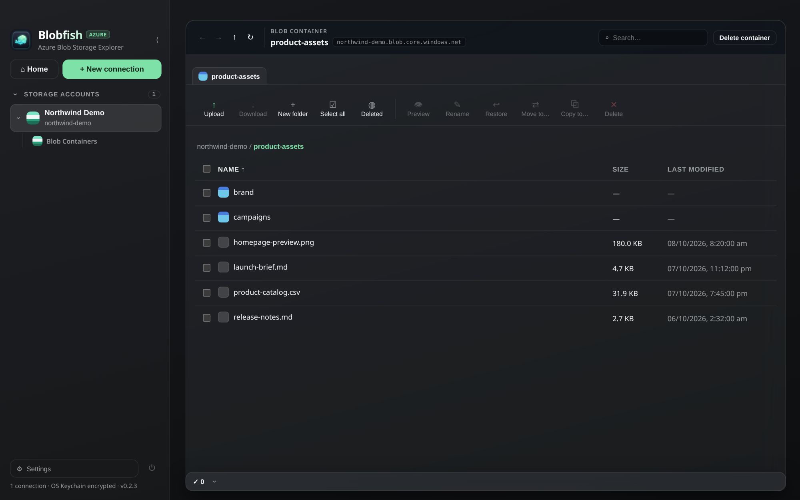

<div align="center">


# Blobfish

**Azure Blob Storage, without the busywork.**

A focused desktop explorer for browsing, moving, previewing and transferring blobs.

[](https://github.com/PylotLight/Blobfish/releases/latest)
[](#install)
[](LICENSE)
[](https://github.com/PylotLight/Blobfish/actions/workflows/ci.yml)

[-0A84FF?style=for-the-badge&logo=apple&logoColor=white)](https://github.com/PylotLight/Blobfish/releases/latest)
[](#install)

[Features](#what-it-does) · [Screenshots](#screenshots) · [Install](#install) · [Privacy](#privacy) · [Development](#development)

<br>

<sub>The explorer with sample data. No live Azure account or credentials are used in this screenshot.</sub>
</div>

Blobfish is a desktop app for working with Azure Blob Storage. Keep accounts and containers close at hand, move files without losing sight of transfer progress, and preview common files right in the app. It also works with Azurite for local development.

Blobfish is in beta. The current release is **0.3.0-beta.2**.

## What it does

- **Connect and browse.** Add accounts with connection strings, SAS URLs, account keys or custom endpoints. Move through containers and blob folders, search and sort listings, and pin frequently used locations.
- **Manage blobs.** Upload and download files, create folders, rename, move or copy blobs, and work with deleted items and version history.
- **Track transfers.** Run parallel uploads and downloads with progress, cancel and retry controls, and a dock that keeps working while you browse.
- **Preview before you open another tool.** Read text and CSV files in the app, with range-based loading for larger files.
- **Develop against Azurite.** Set up a local emulator connection for testing without using a live storage account.
- **Keep connection secrets protected.** On macOS, Blobfish uses the operating system's secure storage for credentials rather than saving them as plaintext.

## Screenshots

The screenshot above shows a sample account and fictional container contents. It is included to show the layout and workflow; it does not contain a real account, endpoint or credential.

## Install

Blobfish currently ships as a macOS app for **Apple silicon**, requiring **macOS 12 Monterey or newer**. Download the latest `.dmg` or `.zip` from [GitHub Releases](https://github.com/PylotLight/Blobfish/releases/latest), or install it with Homebrew:

```bash
brew tap pylotlight/blobfish https://github.com/PylotLight/Blobfish.git
brew install --cask blobfish
```

The release builds are not signed or notarized yet, so Gatekeeper may say Blobfish “is damaged and can’t be opened.” If you downloaded it from the official releases, clear the quarantine flag and open it again:

```bash
xattr -cr /Applications/Blobfish.app
```

You can also Control-click the app and choose **Open** on its first launch. Homebrew installs may need the same `xattr` command.

### Run with Bun or npm

```bash
bunx blobfish
# or: npx blobfish
```

The launcher downloads the published app package and a pinned Electron runtime on first use (about 100 MB), then keeps them cached. For regular installs, use Homebrew or a release download above.

## Privacy

There is no Blobfish account or sync service. On macOS, connection secrets are stored using the operating system's secure storage; they are not written to app files as plaintext. Use [Azurite](https://learn.microsoft.com/azure/storage/common/storage-use-azurite) when you want to develop against a local storage emulator instead of a live Azure account.

## Development

For setup and run instructions, see [Getting started](docs/getting-started.md). For architecture, troubleshooting and release instructions, see the [project docs](docs/) and [release guide](docs/releasing.md).

## License

[MIT](LICENSE).
